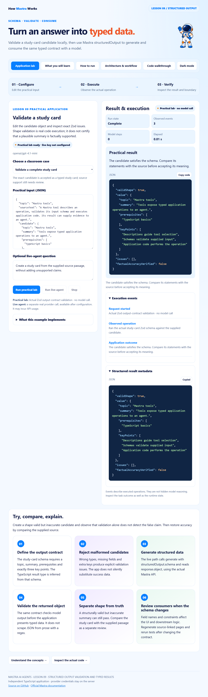

# Mastra · Lesson 09 · Structured Output Validation and Typed Results

Validate a study-card candidate locally, then use Mastra structuredOutput to generate and consume the same typed contract with a model.



## Start

Use Node.js 24+. This is an independent repository.

```powershell
git clone https://github.com/luiscoco/Udemy-Mastra-lesson09-app.git
cd Udemy-Mastra-lesson09-app
npm ci
npm start
```

Open http://127.0.0.1:3209. **Run practical lab** executes: Actual Zod output-contract validation · no model call. Starting the host makes no model call.

## Five student pages

Application lab · What you will learn · How to run · Architecture & workflow · Code walkthrough. They preserve the approved lesson 1 astronaut, typography, colors, light/dark theme, responsive layout, safe Markdown rendering, syntax colors and copy-code controls.

## Implemented exercise

Edit the candidate object and inspect exact Zod issues. Shape validation is real code execution; it does not certify that a plausible summary is factually supported.

- **Validate a complete study card:** The exact candidate is accepted as a typed study card; source support still needs review.
- **Reject malformed output:** Missing and incorrectly typed fields are reported, without a fabricated fallback object.

Local mode validates the submitted object and makes no model call. Live mode uses real Mastra structured output. Both paths distinguish structural validity from factual support.

## Optional actual model run

Preserve any existing local configuration. No credential has been copied from another app.

```powershell
if (!(Test-Path .env)) { Copy-Item .env.example .env }
notepad .env
```

Enter your own provider key, choose a model your account can access, and restart. Keys stay on the server and are ignored by Git. Shell values take precedence over the optional file. Live generation may incur provider usage; the normal practical operation does not.

```dotenv
# Set your own provider credential locally. No credential is copied from another app.
OPENAI_API_KEY=your_api_key
MASTRA_MODEL=openai/gpt-4.1-mini
PORT=3209
```

## Build and test

```powershell
npm run sample
npm run sample:live
npm run build
npm test
npm run test:browser
```

The normal sample executes the real key-free operation. The live sample requires provider configuration. Offline SDK integration tests use Mastra's explicit model-test adapter and do not make paid model calls. Browser tests execute the real local lab, navigate all five pages, check responsive behavior and safe code rendering, and capture this app's own preview. Set BROWSER_EXECUTABLE for a nonstandard Chrome/Chromium path.

Source-linked excerpts and the browser script are generated from the actual implementation. Rebuild after editing source. Generated public files and dependency lockfiles are committed for reproducibility.

## Student exercise

Create a shape-valid but inaccurate candidate and observe that validation alone does not detect the false claim. Then restore accuracy by comparing the supplied source.

## Key source files

- [src/lab.ts](src/lab.ts)
- [src/mastra/schema.ts](src/mastra/schema.ts)
- [src/mastra/agents.ts](src/mastra/agents.ts)
- [src/mastra/index.ts](src/mastra/index.ts)
- [Request host](src/server.ts)
- [Execution envelope](src/runner.ts)
- [Student page generator](scripts/build-pages.ts)

## References

- [Approved lesson 1 baseline](https://github.com/luiscoco/Udemy-Mastra-lesson01-app)
- [Structured output](https://mastra.ai/docs/agents/structured-output)
- [Agent generation](https://mastra.ai/reference/agents/generate)

The astronaut, base styles and Prism integration follow the user's approved course assets. Prism's license remains in public/prism-LICENSE.txt. This application's lesson-specific operations, contracts, examples and explanations are tailored to Lesson 9.
